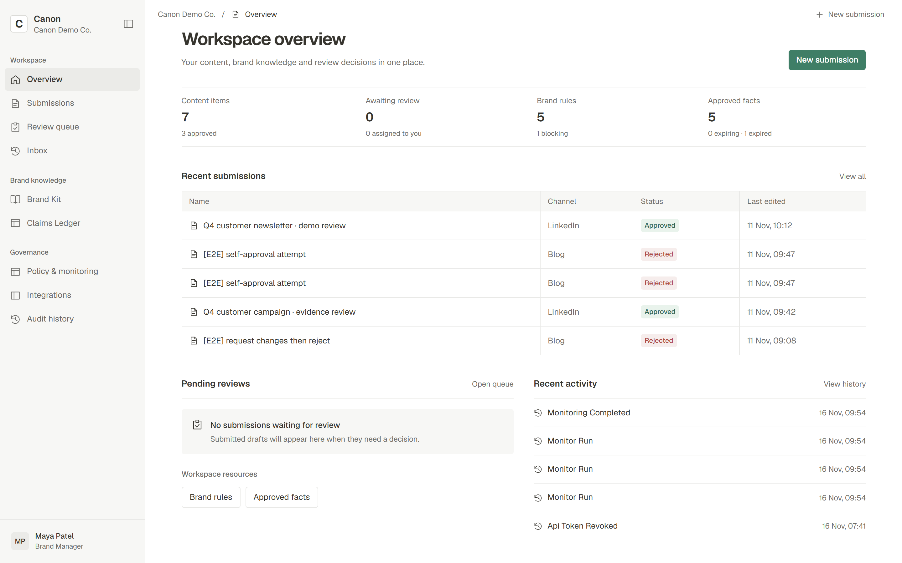
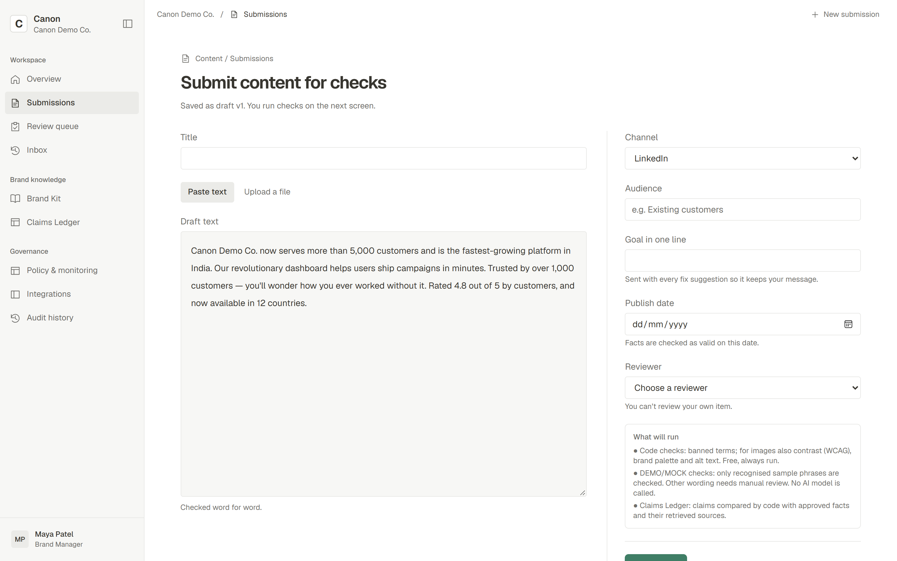
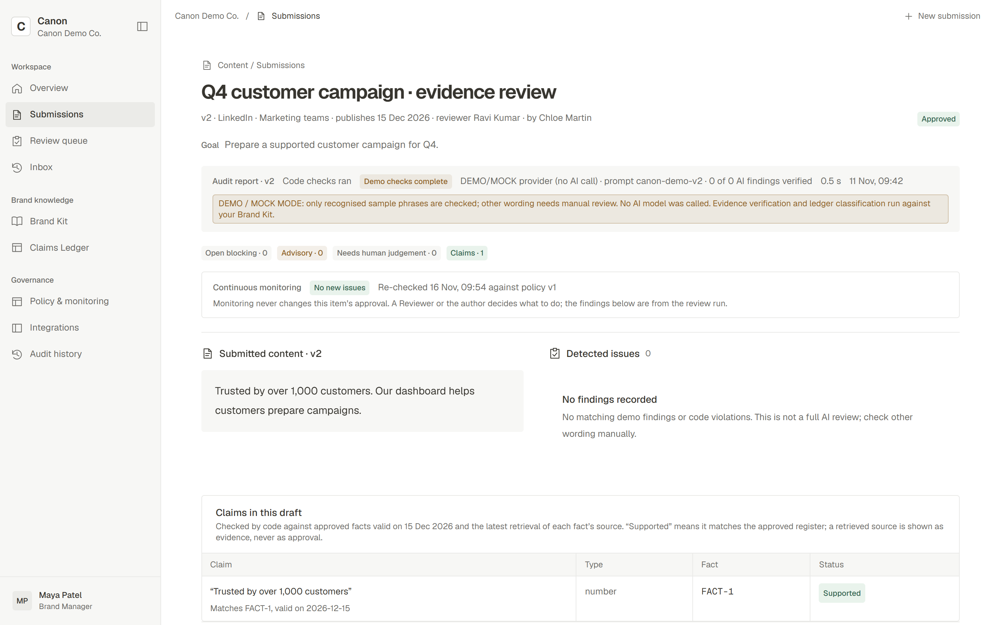
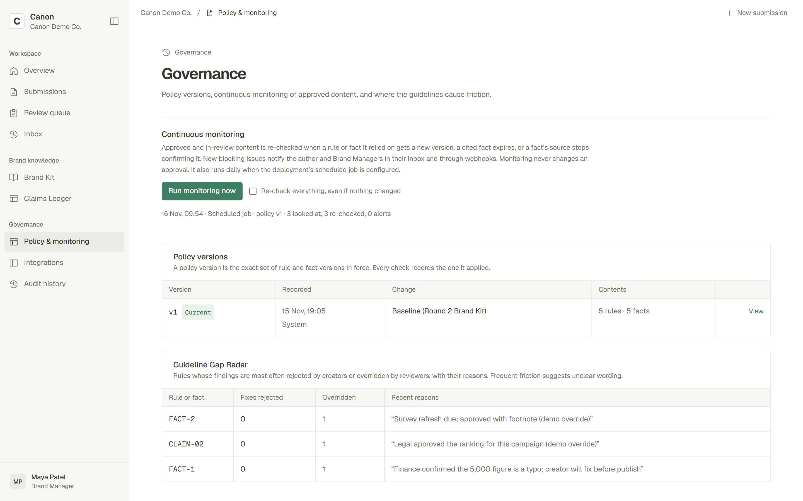
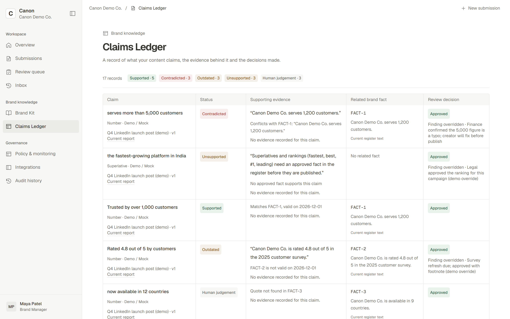
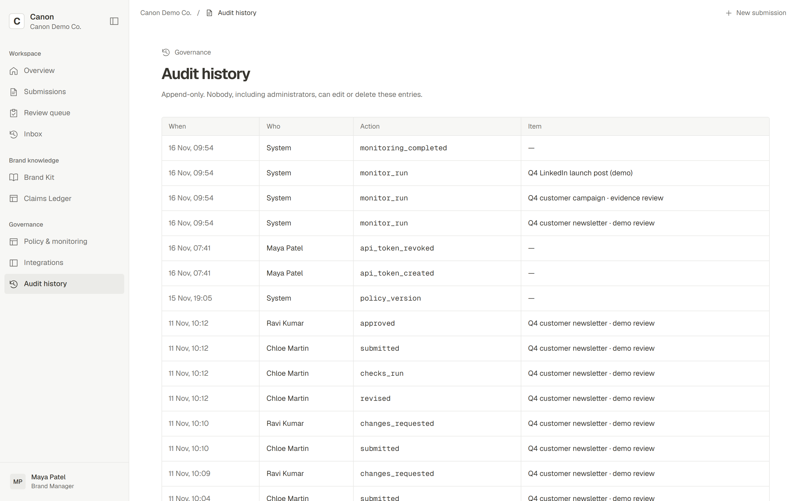

# CANON – Brand Governance Platform

**CodeTitans India 2026 — Round 3 Submission**

**Team:** CODEX
**Institution:** CHRIST (Deemed to be University), Kengeri Campus
**Team Members:** Yoson Y · Raphael Roger A · Bryan Donato Anand · Macario Andric

**Live Application:** https://canon-rose.vercel.app
**GitHub:** https://github.com/yo5on/Canon
**Production commit:** `87904388`

Canon reviews content against an organisation's approved brand rules, terminology, facts and visual guidelines before publication. It shows what was flagged, why and on what evidence, and it keeps a person responsible for every publishing decision.

---

## Contents

1. Problem Statement
2. Our Solution
3. Round 3 Improvements
4. Claims Ledger
5. Review and Accountability
6. Technology and Architecture
7. Security and Reliability
8. Production Deployment
9. Current AI Provider Disclosure
10. Limitations
11. Future Scope
12. Conclusion
- Appendix A: Verification Status
- Appendix B: Round 2 Commitments and Delivery

---

## 1. Problem Statement

Organisations publish marketing content across many platforms, teams and formats. Keeping brand identity, claims, approved terminology and policy compliance consistent across all of it is difficult.

Manual review is slow, inconsistent and hard to audit. Reviewers can miss outdated facts, unsupported claims, incorrect terminology or departures from approved brand guidelines, and there is often no record of why a piece of content was approved.

> **What goes wrong.** A figure from last year's survey is reused after it expires. A superlative ("the fastest-growing") is published without an approved fact behind it. A banned term slips into a caption on an image that no text checker reads.

> **What is missing.** A single place that checks every format against the same approved rules and facts, shows the evidence for each finding, and records who decided what, and why.

## 2. Our Solution

Canon reviews content against the organisation's approved brand rules, terminology, facts and visual guidelines before publication. It shows what was flagged, why and on what evidence. Canon never publishes anything itself.

Canon follows one workflow:

**Submit → Analyse → Inspect Findings → Review Evidence → Decide → Audit**

| Step | What happens |
|---|---|
| Submit | A Creator pastes text or uploads a PDF, DOCX or image. The draft is saved as a version. |
| Analyse | Deterministic code checks run. The AI provider (mock in production) proposes findings and claims; code verifies every quote and decides each claim's status against the approved fact register. |
| Inspect findings | Each finding cites the exact rule or fact it relies on, quoted word for word. |
| Review evidence | Reviewers see the matched fact, its validity dates and the latest retrieval of its source. |
| Decide | A Reviewer approves, requests changes or rejects; overriding a finding requires a reason. |
| Audit | Every action is written to an append-only audit log. |

*Workspace overview: content items, pending reviews and recent activity, including scheduled monitoring runs. Live application, demo workspace, 16 Nov 2026.*

## 3. Round 3 Improvements

### A. Multimodal Brand Compliance

Canon accepts four kinds of content in the same review workflow (`src/lib/extract.ts`):

| Format | How it is read |
|---|---|
| Text | Pasted directly into the submission form. |
| PDF | Text layer extracted page by page. A PDF with no text layer (a scan) is rejected with a message asking for images instead. |
| DOCX | Paragraph text extracted. Legacy `.doc` files are rejected with a clear message. |
| PNG, JPEG, WebP | Optical character recognition (OCR) with Tesseract.js, using the bundled English model. OCR runs on the server with no network call. |

- Files are identified by their content (magic bytes), not only by extension. The upload limit is 10 MB; images are limited to 40 megapixels.
- Every extracted line keeps a reference back to its page, paragraph or image region, so a finding can point to where it came from.
- Uploads go to a private Supabase Storage bucket (`content-sources`) through short-lived signed URLs.
- Image assets also get deterministic visual checks (`src/lib/visualchecks.ts`): WCAG 2.2 contrast ratio of each OCR line, dominant colours compared with the brand palette, and alt-text presence.

*Submit content: paste text or upload a file. The panel on the right lists exactly what will run, including the DEMO/MOCK notice. The draft text shown is the prefilled demo sample.*

### B. Live Fact Verification and Source Intelligence

Each approved fact can cite a source page. Canon can retrieve that page and check whether it still states the fact (`src/lib/sources.ts`).

**Approved fact → `safeFetch` (guarded retrieval) → code compares page with fact → recorded outcome**

- Retrieval goes through `safeFetch`, which only fetches **https** URLs on **domains the workspace has approved**. Hosts that resolve to private or internal IP addresses are blocked, and requests have a timeout and a size limit.
- Code, not a model, compares the page with the fact. Each check records one outcome: `confirmed`, `not_found`, `changed`, `unavailable` or `blocked`.
- Retrieved text is **evidence for a reviewer**. It never turns a claim SUPPORTED on its own.

Together with the fact register, this lets Canon identify unsupported claims, contradictory information, outdated facts, and claims that need human judgement.

*Audit report: the DEMO/MOCK label, continuous-monitoring status (re-checked against policy v1) and the claims table. The claim matches FACT-1, valid on the publish date. The note above the table explains that a retrieved source is shown as evidence, never as approval.*

### C. Continuous Brand Governance and Integrations

Governance continues after approval.

| Capability | What it does |
|---|---|
| Policy versions | A policy version is the exact set of rule and fact versions in force. Every analysis run records the version it applied, and each rule or fact has a field-by-field, word-level change history. |
| Continuous monitoring | Approved and in-review content is re-checked when a rule or fact it relied on changes, a cited fact expires, or a fact's source stops confirming it (`src/lib/monitor.ts`). Monitoring never changes an approval; new blocking issues raise an alert. Runs on demand, and a daily scheduled job is defined in `vercel.json`. |
| Notifications | Review events and monitoring alerts appear in each user's inbox. |
| Webhooks | Events (`submitted`, `approved`, `rejected`, `changes_requested`, `monitor_alert`, `source_changed`) are sent to a Slack-compatible incoming webhook or as signed JSON (HMAC-SHA256, `x-canon-signature`). Every delivery attempt is logged. |
| Publish-gate API | `GET /api/v1/items/:id/gate` answers whether an item may be published: it must be approved, the approved version must be current, there must be no open blocking issues and, if a SHA-256 hash is supplied, the text must match the approved text exactly. Read-only, workspace-scoped tokens, stored only as hashes. |

*Governance: monitoring controls and the last scheduled run (16 Nov, 09:54), policy version v1 with its contents, and the Guideline Gap Radar listing override reasons.*

## 4. Claims Ledger

The Claims Ledger records every factual claim in a draft and its outcome. **Code, not the model, decides each status** (`src/lib/ledger.ts`):

| Status | Meaning |
|---|---|
| SUPPORTED | Matches an approved fact that is current on the publish date |
| CONTRADICTED | Evidence conflicts with the claim |
| OUTDATED | Claim is no longer current |
| UNSUPPORTED | Sufficient supporting evidence is unavailable |
| HUMAN_JUDGEMENT | Requires a human decision |

> **What SUPPORTED means.** SUPPORTED means the claim matches the organisation's approved facts, not that its truth has been independently established in the real world.

Statuses are checked in a fixed order, and the first match wins: HUMAN_JUDGEMENT → CONTRADICTED → SUPPORTED → OUTDATED → UNSUPPORTED. For example, if a cited quote cannot be found in the fact it names, the claim goes to HUMAN_JUDGEMENT rather than being shown as fact.

*Claims Ledger: each claim with its status, the evidence behind it, the related approved fact and the review decision, including override reasons. Demo workspace data; the claims come from the mock provider.*

## 5. Review and Accountability

| Role | Responsibilities |
|---|---|
| Creator | Submits text, PDF, DOCX or images and runs checks. |
| Reviewer | Works through the review queue and decides on findings and submissions. |
| Brand Manager | Maintains the Brand Kit, trusted sources, policy versions, monitoring and integrations. |

- A Creator cannot approve their own work, and a reviewer must belong to the item's workspace and cannot be its author. These rules are enforced in the database.
- Overriding a finding requires a written reason, checked by the server action and by a database constraint. Reasons appear on the Governance page's *Guideline Gap Radar*, which lists the rules most often rejected or overridden.
- Every state change is written to an append-only audit log that no user, including administrators, can edit or delete through the application.

*Audit history: append-only record of review decisions, monitoring runs, policy versions and API token events, with who acted and on which item.*

## 6. Technology and Architecture

- **Frontend:** React, TypeScript and Next.js (App Router)
- **Backend:** Next.js server-side API routes. (The earlier Python/FastAPI prototype was retired.)
- **Database:** Supabase PostgreSQL
- **Authentication:** Supabase Auth
- **Authorisation:** role-based access control and Row Level Security
- **Storage:** private Supabase Storage
- **Extraction:** unpdf, mammoth, sharp, Tesseract.js
- **Deployment:** Vercel

**System architecture.**

| Layer | Components |
|---|---|
| Client | Browser (Creator, Reviewer, Brand Manager; Supabase Auth session). Machine clients: CMS or pipeline calling the publish-gate API with a bearer token; Vercel Cron running the daily monitoring job. |
| Vercel · Next.js | Server components read with the user's session, so RLS applies; server actions for reviews and Brand Kit edits. API routes: `/api/uploads`, `/api/items/from-file`, `/api/items/:id/analyze`, `/api/v1/items`, `/api/v1/items/:id/gate`, `/api/cron/monitor`. Shared library: extraction, code checks, verifier, Claims Ledger, monitoring, webhooks. |
| AI provider | DEMO/MOCK in production: fixed responses for sample phrases; no model is called. A live-model path exists in code but is not enabled. |
| Supabase | PostgreSQL with Row Level Security, role-checked state-change functions, an approval trigger and an append-only audit log; Auth (email sign-in, demo accounts); private `content-sources` Storage bucket. |
| Outbound | Source retrieval through `safeFetch` (approved domains, https only, private addresses blocked); webhooks (Slack-compatible or HMAC-signed JSON, https only, every attempt logged). |

**Analysis pipeline (one run).**

1. **Code checks:** banned terms; contrast, palette and alt text for images.
2. **Provider proposals:** findings and claims (mock in production).
3. **Citation verifier:** every quoted rule or fact must exist word for word.
4. **Claims Ledger:** status decided in code against the fact register.
5. **Store:** results saved with the policy version applied.

Reads made for a user use that user's session, so Postgres RLS decides what they see. Pipeline writes use a server-only service client. Submit, approve and reject go through database functions that check the caller's role.

## 7. Security and Reliability

**Implemented in the repository:**

- Row Level Security enabled on all 20 tables created by the migrations (13 in `0001_init.sql`, 7 in `0005_round3.sql`); a read-only query on production found no public table without it.
- Workspace isolation for items, findings, claims, sources, notifications and Storage folders.
- API tokens stored only as SHA-256 hashes; the plain token is shown once.
- Outgoing requests (source retrieval, webhooks) limited to https and blocked from private addresses.
- Webhook payloads signed with HMAC-SHA256.
- Append-only audit log, source checks and policy versions.
- A scheduled-job endpoint that refuses to run unless `CRON_SECRET` is configured.
- The Round 3 production migration (`supabase/apply-round3-production.sql`) runs in a single transaction, with a production fingerprint guard, preflight checks and verification queries.

**Round 3 production hardening.** Applied to the production database in a separate step after the main migration, and confirmed on 16 Nov 2026 with a read-only catalog query (privileges, policies and function body):

- Restricted access to API token hashes.
- One-way API token revocation (a revoked token cannot be re-enabled).
- Workspace-scoped notification generation.
- Membership-aware notification access.
- Safer Storage folder-name validation.

> **Note:** these changes are **not part of production commit `87904388`**. They are now written as the re-runnable migration `supabase/migrations/0007_round3_hardening.sql`, tested locally to produce the same schema as the production path. At the time of writing it is in the team's working copy and **not yet committed** to the public repository.

**Checks run during this review (16 Nov 2026, on the repository at `87904388`):**

| Check | Result |
|---|---|
| `npx tsc --noEmit` | Passed, no errors |
| `npm run lint` | Passed: 0 errors, 3 warnings |
| `vitest run` (13 test files) | 110 / 110 passed. The live RLS test (`src/lib/rls.live.test.ts`) was excluded because it connects to the live database. |
| Working copy with the final-review fixes | `tsc` passed; lint 0 errors, 3 warnings; `vitest` 113 / 113 passed in 14 files (live RLS test excluded); migration 0007 test 27 / 27 on local PostgreSQL 17 and 18 (PGlite). |

## 8. Production Deployment

**Application:** https://canon-rose.vercel.app

| Item | Status |
|---|---|
| Vercel deployment | READY, checked through the Vercel API during this review |
| Commit deployed | `87904388` on `main`: "Add transactional, re-runnable Round 3 production migration with preflight and verification queries" |
| Smoke test | During this review, the Brand Manager one-click demo sign-in and read-only pages (overview, submission report, Claims Ledger, Governance, Integrations, Brand Kit, Audit history) were checked on production. The team's earlier smoke tests also covered the Reviewer and Creator demo sign-ins; those were not repeated here. |
| Scheduled monitoring | The production Governance page shows a scheduled monitoring run on 16 Nov, 09:54. |

## 9. Current AI Provider Disclosure

The production deployment uses the **demo/mock AI provider** (`src/lib/ai.mock.ts`, enabled by `CANON_AI_MOCK`).

- No AI model is called. Runs are stored with the model name `mock`, and every report is labelled **DEMO/MOCK provider (no AI call)**.
- The mock provider returns a fixed response for recognised sample phrases. Other wording is not analysed and needs manual review. This is **not** general AI analysis.
- The code checks, citation verifier, Claims Ledger, source retrieval, review workflow, monitoring and audit log all run for real on that response.
- The repository also contains a live-model code path (`src/lib/ai.ts`) that uses the Anthropic SDK when a key is configured and mock mode is off. It is **not enabled in production**, and this document does not describe its output.

> **What was observed.** The production login page, which computes its AI status from the server environment, reports the mock provider. Every report viewed during this review is labelled DEMO/MOCK; the code records a run as `mock` only when `CANON_AI_MOCK=1`. The production environment variables themselves were not inspected.

**What is real in this deployment** (summarised from the table on the production login page):

| Capability | Status in production |
|---|---|
| Sign-in, roles, Row Level Security | Real |
| PDF and DOCX text extraction, image OCR | Real, runs on the server |
| Banned terms, contrast, palette, alt text | Real, deterministic code checks |
| Fact register and claim statuses | Real, decided by code |
| Trusted-source retrieval | Real, https, approved domains |
| Policy versions, monitoring, webhooks, publish-gate API | Real |
| AI rule and claim review | Demo / mock, no model called |

## 10. Limitations

| Limitation | Detail |
|---|---|
| AI analysis is mocked | Only recognised sample phrases produce AI findings in production; everything else needs manual review. |
| SUPPORTED is register-based | It means a claim matches the organisation's approved facts, not that the claim is independently true. |
| English-only OCR | Results depend on image quality. Scanned PDFs without a text layer must be uploaded as images. |
| HTML-only retrieval | Source retrieval reads page HTML only. Content rendered by JavaScript or behind a login is not seen. |
| Hardening migration uncommitted | Migration `0007`, which matches the hardening already on production, is not yet in the public repository (Section 7). |
| No native CMS integration | Integration is through the publish-gate API and webhooks. There is no CMS plugin or connector (Appendix B). |
| Leaked-password protection | Not enabled at the time of the team's security review (`docs/SECURITY_HARDENING.md`), because the Supabase project is on the Free plan. |

## 11. Future Scope

- Enable live model analysis behind the existing schema validation, verifier, Claims Ledger and daily token budget.
- Commit migration `0007_round3_hardening.sql` so the public repository matches the production schema.
- Add more OCR languages and layout-aware extraction for multi-column PDFs.
- Native connectors for common CMS and design tools that call the existing publish-gate API.

## 12. Conclusion

Canon makes brand governance structured, transparent and accountable. It combines multimodal content intake, source-aware fact review, a Claims Ledger decided by code, versioned policies, continuous monitoring and human decision-making in one workflow, and it states clearly which parts are live and which run in demo mode.

**CODEX — Building accountable brand governance with Canon.**

---

## Appendix A: Verification Status

Key: **Repo** = read in the source code · **Run** = checked during this review · **Observed** = seen in the live application · **Team** = reported by the team, not re-checked here.

| Claim | Basis | Status |
|---|---|---|
| PDF, DOCX, PNG, JPEG and WebP extraction | `src/lib/extract.ts`, `src/lib/items.ts` | Repo |
| Offline English OCR with the bundled Tesseract.js model | `src/lib/extract.ts`, `next.config.ts` | Repo |
| Five Claims Ledger statuses, decided in code | `src/lib/ledger.ts` | Repo |
| Source retrieval limited to approved https domains | `safeFetch` in `src/lib/sources.ts` | Repo |
| Policy versions, monitoring, webhooks, publish-gate API | `src/lib/monitor.ts`, `src/lib/webhooks.ts`, `src/app/api/v1/` | Repo |
| Override reasons required; one-time token display | `submissions/[id]/actions.ts`, `integrations/actions.ts`, `0001_init.sql` | Repo |
| Type check, lint, unit tests | Run locally (Section 7) | Run |
| Production deployment READY on `87904388` | Vercel API | Run |
| Brand Manager sign-in and pages work in production | Live application, 16 Nov 2026 | Run |
| Production uses the mock provider | Login page status and DEMO/MOCK labels on reports; environment variables not inspected | Observed |
| Scheduled monitoring runs in production | Governance page shows a scheduled run | Observed |
| Reviewer and Creator smoke tests | Team's earlier production smoke test | Team |
| Token, notification and Storage hardening in production | Read-only catalog query on production, 16 Nov 2026 | Run |
| `CRON_SECRET` configured in production | Team's earlier check (endpoint returns 401, not 503) | Team |

Every screenshot in this document was captured from the live application on 16 November 2026, in the fictional *Canon Demo Co.* workspace, signed in as the demo Brand Manager. That sign-in used the application's own demo button, which resets the demo account's email and password to their configured values before signing in. Apart from that, nothing in the production application, its data, Supabase or Vercel settings was changed while preparing this document. No secrets or environment values appear in it, and the production login page, which shows the demo account passwords, was deliberately not included as a screenshot.

---

## Appendix B: Round 2 Commitments and Delivery

Each line is a promise from Section 08 of our Round 2 submission, checked against the code.

| Round 2 promise | Status | What exists |
|---|---|---|
| **1 · Multimodal Brand Compliance** | | |
| PDF and DOCX extraction mapped to page and position | PARTIAL | Page (PDF) and paragraph (DOCX) references; no layout coordinates. `extract.ts` |
| Palette, contrast and text-in-image checks | DELIVERED | Server OCR, WCAG contrast per OCR line, palette comparison. `visualchecks.ts` |
| Logo-use checks | NOT DONE | No logo detection. |
| Accessibility checks in code (contrast, alt text) | DELIVERED | Deterministic code checks stored as versioned rule rows. |
| Visual findings cite a verified region | DELIVERED | A region outside the image is downgraded and cannot block. |
| Brand Kit asset library (logos, palette, fonts) | PARTIAL | Palette is stored as rule parameters; no logo or font library. |
| **2 · Live Fact Verification and Source Intelligence** | | |
| Workspace-approved trusted sources | DELIVERED | Per-workspace domain allowlist; https only, private addresses blocked, every redirect re-checked. `sources.ts` |
| Source reference on each fact, shown on each claim | DELIVERED | Register evidence and retrieved evidence are stored and shown separately. |
| Detect claims made outdated by a source change; notify the fact owner | PARTIAL | Source checks are run on demand by a Brand Manager. A `changed` outcome alerts the workspace's Brand Managers and is picked up by the next monitoring run. The fact's named owner is not notified individually. |
| A retrieved source is evidence, never automatic SUPPORTED | DELIVERED | Covered by unit tests. `ledger.ts` |
| Send relevant facts instead of the whole register | DELIVERED | Large registers ranked by word overlap with the draft. Not exercised in production, where no model is called. |
| **3 · Continuous Brand Governance and Integrations** | | |
| Integrations with publishing platforms | PARTIAL | Generic publish-gate API, Slack-compatible and signed-JSON webhooks. **No native CMS integration.** |
| Version-aware policies recorded on every check | DELIVERED | Policy versions, per-run policy copy, word-level change history. |
| Preview a policy change against recent content | NOT DONE | Changes apply first; monitoring then re-checks affected content. |
| Re-check content when a fact expires or a rule changes | DELIVERED | Daily scheduled job and on-demand runs. `monitor.ts` |
| Background jobs with retries, audit entry per run | PARTIAL | Audit entry per monitoring run; analysis is still synchronous; no job queue or retry beyond the AI SDK's. |
| Guideline Gap Radar from override reasons | DELIVERED | Governance page. |
| Humans approve; integrations never publish | DELIVERED | The gate API is read-only; the database requires a human approver who is not the author. |
| **Reliability work** | | |
| Live inference in production | NOT DONE | Production uses the DEMO/MOCK provider (Section 9). |
| Measure on Canon Bench before reporting accuracy | NOT DONE | No benchmark was run, and no accuracy figure is claimed. |
